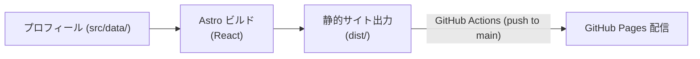

# Dev Log

個人開発の制作物や開発経験を紹介するポートフォリオサイトです。
Astro と React を組み合わせて構築し、GitHub Actions 経由で GitHub Pages に静的ホスティングしています。

公開サイト: <https://shin4488.github.io/dev-log/>

## サイトの構成と公開フロー



## 主な技術スタック

| 分類                 | 技術                                  |
| -------------------- | ------------------------------------- |
| フレームワーク       | Astro, React                          |
| スタイリング         | Vanilla CSS, Bootstrap                |
| テスト・品質管理     | Vitest, Playwright, Biome, TypeScript |
| パッケージマネージャ | Yarn (v4)                             |

## 開発環境のセットアップ

```bash
# Corepack を有効化して依存関係をインストール
corepack enable
yarn install --immutable

# 開発サーバの起動（http://localhost:8000/dev-log/）
yarn dev

# プロダクションビルド
yarn build

# ビルド成果物のローカル確認（http://localhost:9000/dev-log/）
yarn serve
```

### テストと検証

```bash
yarn typecheck    # TypeScript の型検査
yarn lint         # Biome による静的解析
yarn test         # Vitest による単体テスト
yarn test:dev     # Playwright による開発サーバでのページ表示とホットリロードのテスト

# Playwright による本番ビルドのページ表示と操作のテスト（計測のテストのため、仮の測定IDでビルドする）
GOOGLE_ANALYTICS_MEASUREMENT_ID=G-TEST yarn build
yarn test:e2e
```

## 多言語対応

日本語版と英語版のページは、それぞれのURLに静的に生成するため、直接アクセスや再読み込みにも対応しています。

| ページ | 日本語             | 英語                                 |
| ------ | ------------------ | ------------------------------------ |
| トップ | `/dev-log/ja/`     | `/dev-log/`                          |
| 404    | `/dev-log/ja/404/` | `/dev-log/404/`、`/dev-log/404.html` |

通常の画面はトップページのみです。重複していた `/dev-log/about/` と `/dev-log/en/about/` は削除し、アクセスすると404を返します。
以前の英語版のURL `/dev-log/en/` は、トップURLへ転送します。

### 表示する言語の決め方

トップURLと404ページは、次の順に確かめて、最初に見つかった日本語か英語で表示します。

1. URLの `?lang=ja` / `?lang=en`
2. 画面右上の「日本語 / English」で選び、ブラウザに保存した言語
3. ブラウザの言語設定（設定の上から順に）
4. 英語

| 開いたページ             | 表示する言語   | 自動の移動                                                                                           |
| ------------------------ | -------------- | ---------------------------------------------------------------------------------------------------- |
| トップURL `/dev-log/`    | 上の順で決める | 日本語に決まったら `/dev-log/ja/` へ移動する。クエリとセクションの指定（`#projects` など）は引き継ぐ |
| 日本語版 `/dev-log/ja/`  | 常に日本語     | なし                                                                                                 |
| 404ページと存在しないURL | 上の順で決める | なし。元のURLと404の応答のまま、文言・ページタイトル・HTMLの言語を切り替える                         |

トップURLからの自動の移動は、ページを開いたとき（リンク、URLの入力、再読み込み）だけ行い、ブラウザの戻る・進むやサイト内の移動では行いません。戻るボタンで英語版のトップに戻れるようにするためです。
自動の移動を英語版のトップURLだけで行うのは、検索エンジンのクローラーが英語のブラウザとして動くためです。こうすると、各言語のページがそれぞれのURLで検索エンジンに登録されます。

### 言語の切り替え

画面右上の「日本語 / English」で切り替えると、同じページの別言語版に移動し、選んだ言語をブラウザに保存します。URLにセクションの指定がある場合は、その指定も引き継ぎます。
ブラウザの保存領域が使えない場合は、選んだ言語を `?lang=ja` / `?lang=en` でURLに付けます。
選んだ言語の保存はReactの初期化を待たずに動くため、ページの読み込み中に切り替えても保存されます。

JavaScriptを無効にした場合も、日英のページ表示とリンクでの切り替えは使えます。404ページの言語の自動判定はJavaScriptで行うため、無効時は通常の404を英語、`/dev-log/ja/404/` を日本語で表示します。

### 関連するファイル

| 処理                                                          | ファイル                                 |
| ------------------------------------------------------------- | ---------------------------------------- |
| 共通の表示文言、言語ごとのURLの処理                           | `src/lib/i18n.ts`                        |
| 作品の翻訳                                                    | `src/data/selfDevelopment.ts`            |
| 技術名と注釈の翻訳                                            | `src/data/skillLevel.ts`                 |
| 表示する言語の判定と、トップURLからの移動                     | `src/components/PreferredLanguage.astro` |
| 切り替えた言語の保存                                          | `src/components/LanguageControls.astro`  |
| ページのメタデータの生成と、404ページで言語を判定した後の更新 | `src/lib/pageMetadata.ts`                |

## ディレクトリ構成

```text
dev-log/
├── src/
│   ├── pages/            # Astro のルーティング・静的ページ生成
│   ├── views/            # トップページ（自己紹介）と404ページの React 画面
│   ├── components/       # 共有 UI コンポーネント
│   ├── layouts/          # HTML の head（メタデータ・言語判定・計測タグ）を出力する共通レイアウト
│   ├── lib/              # 多言語の文言・URL処理、メタデータ、アイコン画像の生成、計測
│   └── data/             # スキル一覧や作品リンクなどのプロフィールデータ
├── e2e/                  # Playwright のブラウザテスト
└── static/               # ファビコンなどの静的アセット
```
